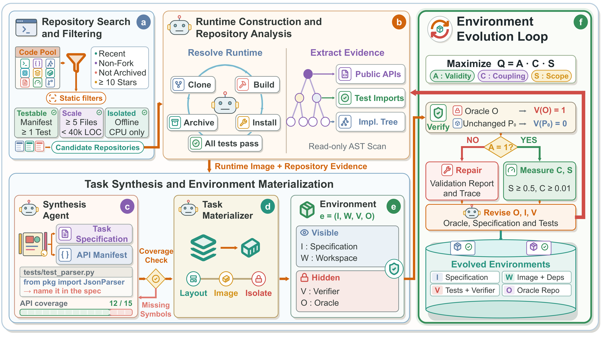
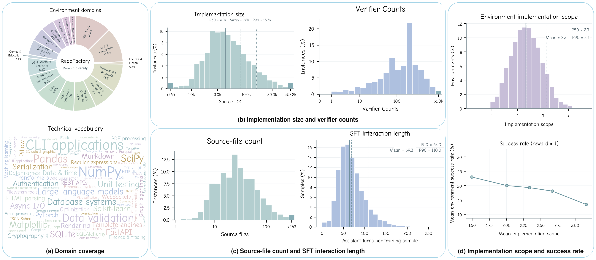
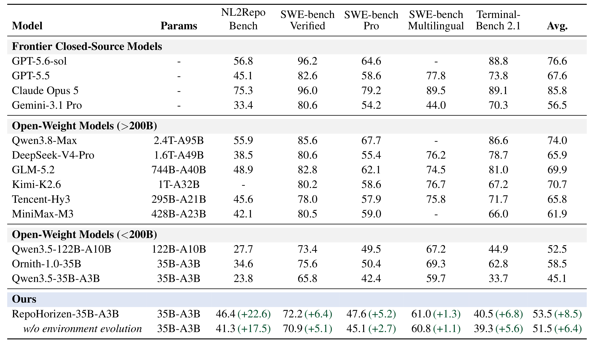

# RepoFactory

**Verifiable environments for long-horizon coding agents.**

<a href="https://huggingface.co/datasets/IQuestLab/RepoFactory"> Hugging Face</a>

RepoFactory converts real-world software projects into training environments for full-repository generation. Given a natural-language specification and API guide, a coding agent builds a complete, working project in an isolated workspace. Dependencies are installed beforehand, and executable tests evaluate the resulting implementation.

The full RepoFactory collection contains **10,159 environments across 17 software domains**. Its Environment Evolution Loop improves candidates under an objective combining **validity**, **implementation scope**, and **structural coupling**. Verifier execution and code analysis guide revisions to the oracle implementation, task specification, and tests, allowing the pipeline to recover unusable candidates and improve the training value of valid environments.

[](assets/pipeline.pdf)

*Overview of RepoFactory and its Environment Evolution Loop. Select the figure to view the PDF.*

## Data release

The initial release contains **200 environments before environment evolution**, together with their prebuilt Docker images. These environments primarily cover Python projects and support trajectory collection, agent training, and research on repository reconstruction.

Task packages and Docker images are available on [Hugging Face](https://huggingface.co/datasets/IQuestLab/RepoFactory). This GitHub repository provides the project documentation and usage instructions.

| Component | Release format |
| --- | --- |
| Environments | 200 |
| Evolution stage | Before the Environment Evolution Loop |
| Task packages | `instances/<id>/instance.tar.gz` |
| Docker image archives | `images/<id>.tar` |
| Docker image tags | `repofactory/task:<id>` |
| Task format | [Harbor](https://github.com/harbor-framework/harbor) |

Each environment includes a task specification, runtime configuration, oracle implementation, and verifier. The oracle and reference tests are provided for validation and must remain outside the solving agent's workspace.

## Dataset statistics

[](assets/data_statistics.pdf)

*Statistics of the full 10,159-environment RepoFactory collection and its SFT data. Select the figure to view the PDF.*

## Main results

Training Qwen3.5-35B-A3B on RepoFactory environments yields **RepoHorizen-35B-A3B**. Environment evolution improves performance over training on environments without evolution across all five evaluated benchmarks.

[](assets/main_results.pdf)

Scores are percentages. Gains in parentheses are percentage-point improvements over Qwen3.5-35B-A3B. A dash indicates an unreported result; averages use the reported benchmarks for each model.

## Quickstart

Start with a single environment. The commands below use `000001` as an example instance ID.

You need Docker with Linux/amd64 container support and a Python environment compatible with Harbor. See the [Harbor installation guide](https://docs.harborframework.com/getting-started/installation) for requirements.

### Install the tools

```bash
python -m pip install --upgrade huggingface_hub harbor
```

### Download an environment

Download a single environment and its Docker image from [IQuestLab/RepoFactory](https://huggingface.co/datasets/IQuestLab/RepoFactory).

```bash
export HF_DATASET_REPO="IQuestLab/RepoFactory"

hf download "$HF_DATASET_REPO" \
  instances/000001/instance.tar.gz \
  images/000001.tar \
  --repo-type dataset \
  --local-dir ./repofactory-data

cd repofactory-data
mkdir -p tasks
tar -xzf instances/000001/instance.tar.gz -C tasks
docker load --input images/000001.tar
```

The extracted task is in `tasks/000001/`. Its configuration uses the prebuilt image `repofactory/task:000001`. Rebuilding the included Dockerfile requires a separately referenced base image, so use the supplied image archive for this release.

### Validate the environment

```bash
harbor run --path tasks/000001 --agent oracle --env docker
harbor run --path tasks/000001 --agent nop --env docker
```

The oracle supplies the reference implementation, while `nop` leaves the initial workspace unchanged. A valid environment gives full reward to the oracle and zero reward to the unchanged workspace. Check the trial results and verifier logs to confirm both outcomes in your setup.

### Run a coding agent

For example, use the Claude Code harness after configuring the corresponding model credentials.

```bash
harbor run \
  --path tasks/000001 \
  --agent claude-code \
  --model "YOUR_MODEL_ID" \
  --env docker
```

See the [Harbor CLI documentation](https://github.com/harbor-framework/docs/blob/main/cli/run.mdx) for supported agents and execution options.

## Environment structure

Each task archive expands into a directory named after its instance ID.

```text
000001/
├── task.toml                 # Runtime, resource limits, and timeouts
├── instruction.md            # Agent instructions
├── start.sh                  # Startup configuration
├── environment/
│   ├── Dockerfile
│   └── start.md              # Project specification and API guide
├── solution/
│   ├── solve.sh              # Oracle entrypoint
│   └── oracle/               # Reference implementation
└── tests/
    ├── test.sh               # Verifier entrypoint
    ├── config.json           # Test configuration
    └── reference/            # Hidden tests and evaluation resources
```

The coding agent works in `/workspace` and reads the specification from `/workspace/start.md`. Verification returns a reward between zero and one, with full reward indicating success. Oracle implementations and evaluation resources must remain separate from the agent during task execution.

